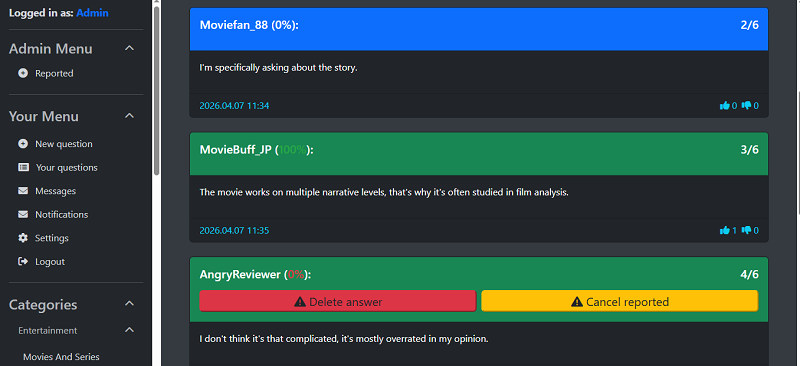
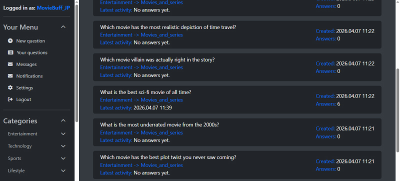
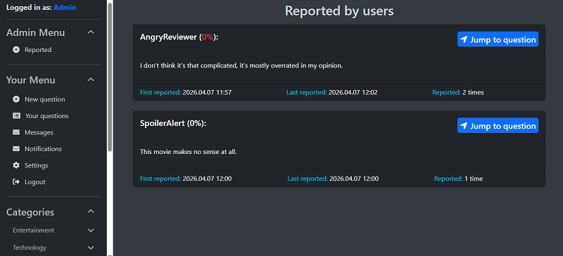
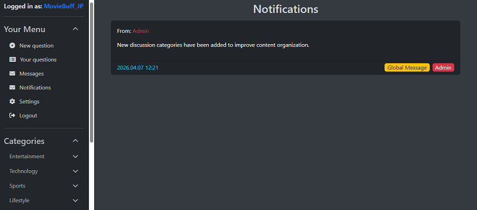
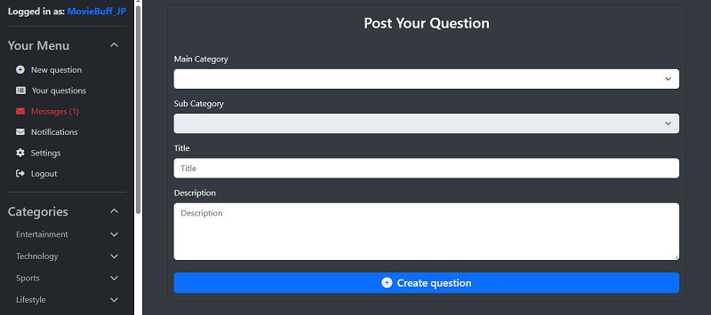

# 💬 Forum Platform (Spring Boot + Angular)

This is a full-stack forum application built to practice and demonstrate **Spring Boot** backend development and **Angular** frontend integration. The project focuses on role-based security, custom query logic using Spring Data JPA, and a messaging system with both private and global messages.

---
## 📄 Table of Contents

* [🛠️ Tech Stack](#tech-stack)
* [💡 Key Features and Preview](#key-features-and-preview)
* [🔎 Technical Implementation Details](#technical-implementation-details)
* [⚙️ Local Setup](#local-setup)

---
## Tech Stack

The application is built using the following core technologies:

| Category | Technologies Used |
| :--- | :--- |
| **Backend** | Java 17+, **Spring Boot 3**, Spring Security, Spring Data JPA |
| **Database** | **PostgreSQL** |
| **Frontend** | **Angular 16** |
| **Security** | **JWT (JSON Web Token) Authentication**, BCrypt password encoding |
| **Realtime** | WebSocket (STOMP), SockJS |

---
## Key Features and Preview

Below are the main functional areas of the application with screenshots from the development environment.

#### 1. Question Detail & Voting

The core of the forum where users interact. Includes a type-safe voting system (Upvote/Downvote) with color-coded ratings and contextual visual feedback.


#### 2. Thread List & Activity

A main dashboard showing all discussions, filtered by categories, with dynamic counters for answers and activity dates.


#### 3. Admin Reported Queue

A dedicated interface for moderators to manage reported content, tracking how many times and when an item was flagged.


#### 4. Global & Private Messaging

Support for both private user-to-user messages and system-wide admin broadcasts, with automated cleanup of expired messages.


#### 5. Real-time Message Alerts

The application provides instant visual feedback when a new private message arrives, without requiring a page refresh. The unread counter updates dynamically in the sidebar.


---
## Technical Implementation Details

### 1. Security & Authentication

* **JWT Implementation:** Used **JSON Web Tokens** for stateless authentication between the backend and the frontend.
* **RBAC (Role-Based Access Control):** Specific actions (like deleting answers or accessing the report queue) are restricted to the Admin role, both on the API level and the UI.
* **API Documentation:** Integrated **OpenAPI (Swagger)** documentation with JWT Bearer authentication support, allowing protected endpoints to be explored and tested directly through the Swagger UI.
* **Initial Setup:** On startup, the application automatically checks for an admin account and creates one if missing (using `CommandLineRunner`) for easier testing.

    * **Default Admin:**
        * Email: `admin@forum.com`
        * Password: `admin123`

    * ⚠️ For demonstration purposes only.

### 2. Messaging System Logic

The messaging system handles two distinct data flows:

* **Private Messages:** Standard "Inbox/Outbox" logic for direct communication between users.
* **Global Notifications:** A broadcast mechanism where Admins can send a single message that appears for every registered user.
* **Visual Indicators:** Used CSS styling to distinguish Admin messages (Red tag) and Global broadcasts (Yellow tag) for better UX.
* **Scheduled Maintenance:** Integrated a **`MessageCleanupJob`** using Spring's **`@Scheduled`** (running every 15 minutes) to identify and delete expired private messages older than 14 days, maintaining database performance.

### 3. Voting & UI Logic

* **Rating Calculation:** The percentage is calculated based on upvotes vs. total votes.
* **Edge Case Handling:** I implemented logic to distinguish between a "no votes yet" state and a "0% rating" (only downvotes), using different color schemes for each.
* **Contextual Styling:** To make threads easier to read, the background color of a response changes if the author is the original creator of the question.

### 4. Data Handling & Moderation

* **Audit Data:** The moderation queue doesn't just show reported posts, but tracks the "first reported" and "last reported" timestamps along with the total frequency.
* **JPA Efficiency:** I used custom JPA queries for database-side aggregation and related-entity statistics, including answer counts, latest-answer dates, and vote statistics.

### 5. Real-time Unread Message Updates

* **Live Notifications:** Integrated **WebSockets** using STOMP and SockJS to provide instant feedback.
* **Unread Message Counter:** When a new private message is sent, the backend calculates the unread count and pushes it specifically to the recipient's UI. Only private messages trigger real-time notifications. Global broadcasts are not counted.
* The UI updates instantly without requiring a page refresh.

### 6. Domain Logic & Type Safety

* **Enum-driven Categorization:** Strict use of Java Enums for main and sub-categories to prevent invalid data states and ensure system integrity.
* **Smart Initialization:** The application uses **`@PostConstruct`** to automatically seed the database with the predefined category hierarchy if it's not already present.
* **Voting Mechanism:** Implemented a type-safe **`VoteType`** Enum to handle interactions, providing a scalable foundation for future rating features.

---

## Local Setup

### Prerequisites

* Java 17 or higher
* Node.js (v18+) and npm
* PostgreSQL server

### 1. Database

1.  Create a database named **`forum_db`**.
2.  Configure your credentials in **`src/main/resources/application-dev.yaml`**:

For reference, the required configuration block looks like this:

```yaml
spring:
  datasource:
    url: jdbc:postgresql://localhost:5432/forum_db
    username: your_username
    password: your_password
  jpa:
    hibernate:
      ddl-auto: update
```

### 2. Security Configuration

The application uses JWT-based authentication. Configure your JWT secret key in: **`src/main/resources/application-dev.yaml`**

The required configuration block looks like this:

```yaml
application:
  security:
    jwt:
      secret-key: your_base64_encoded_jwt_secret_key
      expiration: 86400000
```

Replace `your_base64_encoded_jwt_secret_key` with your own Base64 encoded secret value.

### 3. Backend (Spring Boot)

1. Navigate to the backend directory.
2. Run the application using Maven: **`./mvnw spring-boot:run`**
3. Alternatively, you can run the application directly from your IDE (recommended for development).

The server starts on port 8080 (configurable in application.yaml).

#### 3.1 API Documentation (Swagger)

After starting the backend, the interactive API documentation is available at:

`http://localhost:8080/api/swagger-ui/index.html`

JWT-protected endpoints can be tested directly through the Swagger UI using the built-in authorization support.

### 4. Frontend (Angular)

1. Navigate to the frontend directory.
2. Install dependencies: **`npm install`** 
3. Start the application: **`npm start`** (runs ng serve)
4. Access the UI at: **`http://localhost:4200`**

